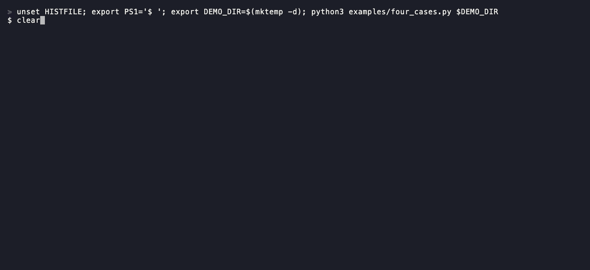

# fk-parent-key

Explain which SQLite parent-key candidates were rejected, and why, before your application starts writing.

[](https://github.com/itzjk/fk-parent-key/actions/workflows/ci.yml)
[](LICENSE)



## Quick start

Install with Python 3.9+ and pipx:

```sh
pipx install git+https://github.com/itzjk/fk-parent-key.git
```

Check an existing, self-contained snapshot:

```sh
fk-parent-key check snapshot.sqlite
```

## Features

- See every index candidate, including rejected candidates alongside a valid one.
- Get independent reasons for non-unique, partial, expression and wrong-column indexes.
- Compare the index collation with the column declaration, with both sources shown.
- Recognize INTEGER PRIMARY KEY columns that have no separate index.
- Feed versioned JSON and explicit coverage into CI without querying business rows.

## Why

SQLite can create a schema successfully and later reject an INSERT with `foreign key mismatch`: some errors require inspecting both tables, as the [SQLite foreign-key documentation](https://www.sqlite.org/foreignkeys.html#required_and_suggested_database_indexes) explains.
Our [four-case reproduction](docs/native-oracle.json) on SQLite 3.51.0 creates four schemas with `integrity_check: ok`, but two fail both `foreign_key_check` and a NULL INSERT.
That is synthetic evidence of the mechanism, with no measured customer demand; the [alternative-tool comparison](docs/alternatives.md) explains the narrower gap this package addresses.

## How it works

The checker groups `foreign_key_list` entries by child table and local FK ID, then combines `table_xinfo`, `index_list`, `index_xinfo` and stored CREATE TABLE SQL. A bounded tokenizer isolates the referenced column declaration and its top-level COLLATE clause. BINARY is assumed only after confirming that clause is absent. Index storage columns marked `key=0` do not count toward the referenced key. The report retains candidates and reasons, so one rejected index never hides another eligible candidate. FK IDs identify relations within this snapshot and can change after a migration.

## Usage

| Command or option | Purpose |
| --- | --- |
| `fk-parent-key check FILE` | Print the relationship report |
| `--json` | Emit report schema version 1, including evidence and coverage |
| `--max-bytes N` | Bound snapshot and relationship evidence bytes, default 104857600 |
| `--max-objects N` | Bound schema and metadata records, default 10000 |
| `--timeout SECONDS` | Analysis deadline, default 5 seconds |
| `fk-parent-key --version` | Show the package version |

Exit codes: **0** means complete analysis with no incompatible relations, **1** means complete analysis with incompatibilities, **2** means incomplete coverage, and **3** means invalid input or an exceeded safety limit. Argument usage errors follow argparse's exit code 2. When coverage is incomplete, JSON still includes known incompatibilities. A database without foreign keys returns an explicit empty inventory and exit 0.

The [report contract](docs/report.md) describes statuses, reason codes and precedence. The [fixture guide](examples/README.md) reproduces all four cases and repairs B and C on separate copies.

## FAQ

**Does an eligible result prove my data is valid?**  
It proves the parent-key schema requirement for that relation. It says nothing about parent rows, CASCADE behavior, query performance or whether your application enables `foreign_keys` on each connection.

**Why not just run foreign_key_check?**  
Use it for SQLite's own checks. It already detects the two demo mismatches. This report explains the candidate rejection instead of returning only the mismatch error.

**Does it change my database?**  
It opens the input as bytes, checks identity and SHA-256 before and after analysis, and queries metadata from a private read-only copy. It runs no migrations, repair operations or trial DML on the input. See [snapshot handling](docs/report.md#snapshot-handling).

**Can I check a running application's database?**  
Supply a consistent, self-contained snapshot created while writers are stopped or through SQLite's backup facilities. The checker rejects WAL-format files and WAL, SHM or journal sidecars. It does not capture an atomic snapshot of a live database.

## Limitations

- Analyzes explicit single-column references between ordinary `main` tables, including WITHOUT ROWID tables.
- Inventories composite and implicit references but marks them not analyzed, alongside unsupported DDL, views, virtual tables, generated parent columns and custom collations.
- Supports BINARY, NOCASE and RTRIM, ASCII simple identifiers and escaped double-quoted names. Other identifier forms are incomplete coverage.
- Requires SQLite 3.37+; reports the actual runtime version. Loads no extensions or user collations.

## Contributing

Run `python3 -m unittest discover -s tests -v`; include a small SQLite fixture and the engine result with a bug report. To install from a clone, run `python3 -m pip install .`.

## License

[MIT](LICENSE).
